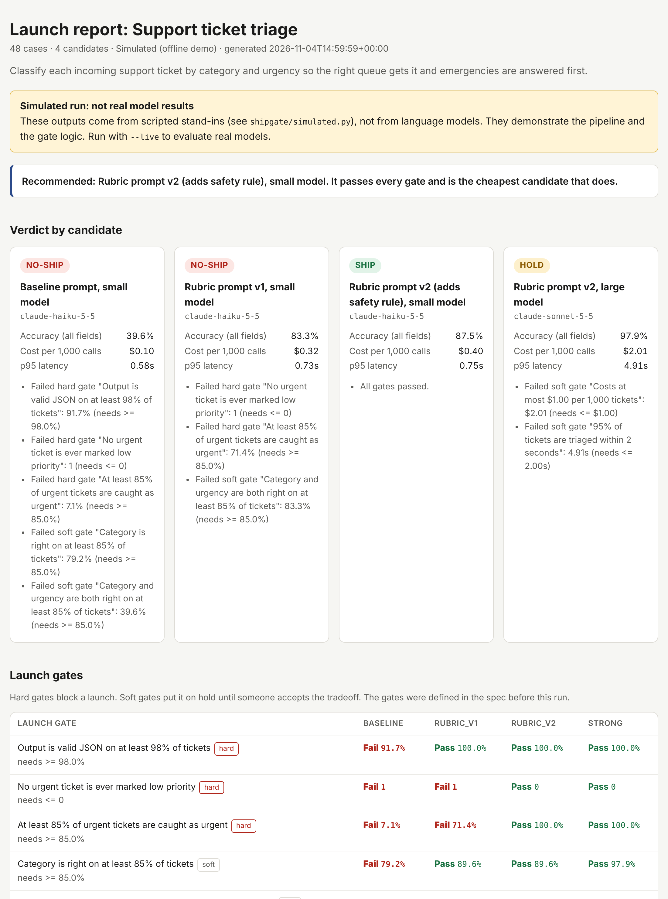
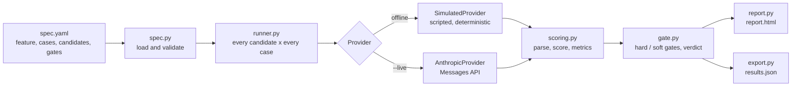

# ShipGate

**Turn a PM's acceptance criteria into evals and a SHIP / HOLD / NO-SHIP launch report for an AI feature.**



> The report above is from the bundled offline demo. Its model outputs come from **scripted stand-ins, not real language models**, and the report says so on its first screen. See [What is real and what is simulated](#what-is-real-and-what-is-simulated).

## The problem

Teams shipping AI features usually decide "is it good enough?" by trying a few examples and trusting a feeling. That fails in predictable ways:

- A prompt tweak fixes one case and quietly breaks others.
- A model swap changes behaviour and nobody notices until a customer does.
- "Good enough" is never written down, so launch reviews turn into opinion fights.
- Cost and latency show up after launch instead of before.

The PM owns the launch call but rarely has a lightweight way to get evidence for it. Most eval tooling is built for ML engineers. None of it ends in the thing a PM must produce: a defensible ship, hold or don't-ship decision.

Full write-up of users, requirements and risks: [docs/PRD.md](docs/PRD.md).

## What it does

1. **You write one YAML spec.** The feature, the test cases, the candidates (prompt plus model) and the **launch gates**: what "good enough" means, written down before you see results.
2. **ShipGate runs every candidate on every case** and scores the outputs.
3. **You get a one-page report** with a verdict per candidate, the reasons behind it, a cost and latency comparison, and where each candidate is weak.

| Verdict | Meaning |
|---|---|
| `SHIP` | Every gate passes. |
| `HOLD` | Only soft gates fail (for example cost). Someone has to accept the tradeoff. |
| `NO-SHIP` | At least one hard gate fails (for example "never bury an urgent ticket"). |

There is deliberately **no combined score**. A weighted average lets a strong headline number hide a failed safety rule; here a hard failure can never be averaged away.

## Try it (no API key needed)

```bash
git clone https://github.com/Shwalak/shipgate.git
cd shipgate
pip install -e .
shipgate run examples/ticket-triage/spec.yaml
```

Then open `out/report.html`. A pre-generated copy lives in [`examples/ticket-triage/sample-output/`](examples/ticket-triage/sample-output/).

## Worked example: should we launch AI ticket triage?

The feature reads a support ticket and returns a `category` (so it reaches the right queue) and an `urgency` (so emergencies are answered first). The example has 48 synthetic tickets, four candidates, and seven gates (3 hard, 4 soft). Everything is in [`examples/ticket-triage/`](examples/ticket-triage/).

Results of the **simulated** demo run:

| Candidate | Verdict | Accuracy (all fields) | Cost / 1k calls | p95 latency | Why |
|---|---|---|---|---|---|
| Baseline prompt, small model | `NO-SHIP` | 39.6% | $0.10 | 0.58s | Invalid JSON on 8% of outputs; catches 1 of 14 urgent tickets |
| Rubric prompt v1, small model | `NO-SHIP` | 83.3% | $0.32 | 0.73s | Decent average, but one urgent ticket buried as low and only 71% of urgent tickets caught |
| Rubric prompt v2 (adds safety rule) | `SHIP` | 87.5% | $0.40 | 0.75s | Passes every gate; cheapest candidate that does |
| Rubric prompt v2, large model | `HOLD` | 97.9% | $2.01 | 4.91s | Most accurate, but fails the cost and latency gates |

What the story shows, which is the point of the tool:

- **v1 looks fine on average (83%) and is still blocked.** The hard gates catch what the headline number hides: a PDF-footer ticket that leaks other customers' project names read as "cosmetic" and got low priority.
- **The fix is a product decision, not a model upgrade.** v2 adds one safety rule to the prompt and passes at a fraction of the large model's cost.
- **The segment table still flags a weak spot in the winner.** v2 gets only 40% accuracy on the security-tagged tickets (it picks the wrong category on some). That is a real risk to discuss before launch, and it is invisible in the 87.5% headline.

The costs use **illustrative** prices in the spec. Replace them with current pricing before reading anything into cost.

## What is real and what is simulated

| Part | Status |
|---|---|
| Spec loading and validation, scoring, metrics, gate logic, verdicts, report | **Real and tested.** |
| Simulated provider (`shipgate/simulated.py`) | Hand-written keyword rules imitating models of different skill. **Not language models.** Output is deterministic and every result is flagged `simulated`. |
| The four verdicts in the demo | Engineered by the simulated profiles to exercise the gate logic. They say nothing about how any real model performs. |
| Live provider (`--live`, Anthropic Messages API) | Implemented and unit-tested against a fake HTTP transport. **Not yet run against the real API in this repo.** |

To evaluate real models, set `ANTHROPIC_API_KEY` and run:

```bash
shipgate run examples/ticket-triage/spec.yaml --live
```

It states how many billable calls it will make and asks for confirmation first (`--yes` to skip). The same prompts in `examples/ticket-triage/prompts/` are what gets sent. Add `temperature: 0` to a candidate if your model supports it, for more repeatable runs.

## Spec format

```yaml
feature: {name: Support ticket triage}
fields: [category, urgency]            # output fields to score
candidates:
  - id: rubric_v2
    prompt_file: prompts/rubric_v2.txt
    model: claude-haiku-5-5
    price_per_mtok: {input: 1.00, output: 5.00}
cases: cases.yaml                      # input + expected + optional tags
forbidden:                             # outcomes that must never happen
  - {field: urgency, expected: urgent, predicted: low}
gates:
  - id: never_bury
    description: No urgent ticket is ever marked low priority
    metric: forbidden_outcomes
    op: "<="
    value: 0
    severity: hard                     # hard blocks launch; soft puts it on hold
```

Metrics: `accuracy`, `recall`, `valid_format_rate`, `forbidden_outcomes`, `cost_per_1k`, `p95_latency_s`. Validate a spec without running anything: `shipgate validate path/to/spec.yaml`. Errors name the exact field to fix, for example `gates[0].metric: unknown metric 'vibes'`.

## Product tradeoffs

The decisions I would defend in a review, and what each one cost:

| Decision | Chose | Gave up | Why |
|---|---|---|---|
| Interface | YAML spec and CLI | A web UI | Specs live in version control next to the feature and get reviewed like code. Ships faster. A UI is the obvious next step. |
| Output | One static HTML file | A hosted dashboard | Shareable by email or PR attachment. No infrastructure, no accounts, nothing that can phone home. |
| Scoring | Deterministic exact-match first | LLM-as-judge | Judges are biased, cost money and are hard to audit. Not in v0.1. |
| Verdict | Three states, hard and soft gates | A single score | A score hides which criterion failed and lets a strong average cover a safety failure. |
| Demo mode | Simulated provider | Requiring an API key | Anyone can run it in one command. Cost: demo numbers prove nothing about real models, so they are labelled everywhere. |
| Test set | Small and hand-written | Large and generated | A reviewer can read every case. Cost: statistical weakness, which the report states. |
| Dependencies | Standard library plus PyYAML | The vendor SDK | Fewer moving parts and an easy install. Cost: I own the HTTP and retry code. |

## Architecture



A plain-English walkthrough of each part is in [docs/how-it-works.md](docs/how-it-works.md).

## Limitations

- **Small samples.** With 48 cases, one case moves accuracy by 2.1 points. The report says so. Treat results as a screen, not proof.
- **Exact-match scoring only.** It suits structured outputs such as classification. Open-ended text needs a different scorer.
- **Sequential runs.** Simple and deterministic, but slow for large live runs.
- **One live provider.** The provider interface is small, so adding another is a contained change.
- **Gates can be gamed.** Nothing stops someone choosing thresholds after seeing results. Commit the spec before the run.
- **Passing is not the same as good.** The verdict is evidence for a launch decision, not the decision.

## Next steps

If I had a team of three engineers for a sprint:

1. A guided spec builder (form to YAML) and a linter that warns about tiny samples.
2. An LLM-as-judge scorer for open-ended outputs, with a way to validate the judge itself.
3. Run history, to compare this week's run with last week's and catch regressions.
4. A CI mode that fails a pull request when a hard gate regresses.
5. Confidence intervals on every metric in the report.
6. More providers behind the existing interface.

## Repository layout

```
shipgate/        the package: spec, providers, scoring, gate, runner, report, cli
examples/        ticket-triage: spec, 48 synthetic cases, prompts, sample output
docs/            PRD.md and how-it-works.md
tests/           unit tests plus a regression test that pins the demo's verdicts
```

Run the tests with `pip install -e ".[dev]" && pytest`.

## About this project

Designed and specified by Saksham as an AI and technical product manager portfolio project, and implemented with Claude Code. The PRD, the gate design and the tradeoffs are the product thinking; the code is the proof it runs.

All example data is synthetic. No real customer data is used.

## License

MIT
